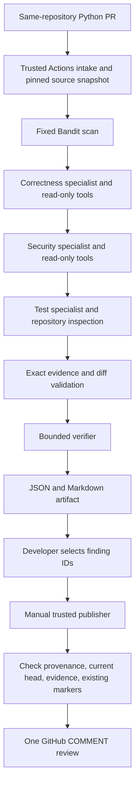

# Architecture

The GitHub workflow controls when analysis runs; the AI controls which bounded inspection tools each specialist uses. Fixed outer orchestration makes state and recovery visible while the inner tool loops investigate dynamically.

LangGraph nodes share serializable review state and use one request budget. Source snapshots and specialist results live for the analysis process. Saved reports survive for seven days as Actions artifacts. Analysis is not resumable after process failure; publication resumes from a completed report without another model call.

The analysis workflow uses `pull_request_target`, restricts the PR to the same public repository and default target branch, and checks out trusted base-side code at `github.sha`. Reviewed files enter through GitHub API reads as data. There is no generic shell tool and no import or execution of reviewed Python.

The reviewer can read source, search literal text, list bounded Python paths, inspect syntax, and request a fixed Bandit scan. Bandit runs in a temporary directory with fixed arguments and `shell=False`; this is constrained subprocess use, not an operating-system sandbox.

Changed enclosing functions and nearby source are delivered as bounded, numbered blocks with application-issued reference IDs. Tools issue the same references for later source reads. Candidates select a delivered reference and a line range; the application constructs the exact redacted quotation and derives its path/source side. Unknown or out-of-window references are rejected. Canonical quotations establish location, while the verifier separately assesses the claimed failure. Physical LF lines preserve GitHub positions even when source strings contain Unicode separators.

Correctness and verification default to Gemini 3.5 Flash Lite with HIGH thinking; security/tests use the same model with MINIMAL thinking. Optional allowlisted Flash 3.6/3.8 reasoning models can be selected explicitly. All adapters share the same 12-request budget, including retries, with three slots reserved for verification. Requests are spaced globally and per model (12.5 seconds for Flash calls, five for Lite). Provider quota failures make checks incomplete; there is no paid fallback. The verifier always receives a structured-output schema and can repair one invalid decision batch inside its two-turn limit. It receives the full bounded review context, returns decisions for every supplied ID, reassesses category/severity, and supplies a corrected fix or test before findings become supported. Supported remains a model judgment requiring human inspection.

The publication workflow runs manually from the default branch. It has a GitHub write token but no model key. It rejects artifacts from other workflows, repositories, revisions, schemas, or expired runs. Findings without supported verification or exact evidence cannot be selected. Test gaps remain review-body findings rather than inline comments. Repeated IDs are skipped; uncertain POST results are reconciled by reading existing reviews.

A report is partial when any required specialist, static scan, source fetch, or verification is incomplete. Model confidence cannot auto-approve a comment. Evidence validation confirms a source location; it does not prove that the AI's interpretation is correct.
