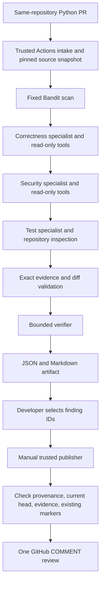

# Architecture

The GitHub workflow controls when analysis runs; the AI controls which bounded inspection tools each specialist uses. Fixed outer orchestration makes state and recovery visible while the inner tool loops investigate dynamically.

LangGraph nodes share serializable review state and use one request budget. Source snapshots and specialist results live for the analysis process. Saved reports survive for seven days as Actions artifacts. Analysis is not resumable after process failure; publication resumes from a completed report without another model call.

The analysis workflow uses `pull_request_target`, restricts the PR to the same public repository and default target branch, and checks out trusted base-side code at `github.sha`. Reviewed files enter through GitHub API reads as data. There is no generic shell tool and no import or execution of reviewed Python.

The reviewer can read source, search literal text, list bounded Python paths, inspect syntax, and request a fixed Bandit scan. Bandit runs in a temporary directory with fixed arguments and `shell=False`; this is constrained subprocess use, not an operating-system sandbox.

The publication workflow runs manually from the default branch. It has a GitHub write token but no model key. It rejects artifacts from other workflows, repositories, revisions, schemas, or expired runs. Findings without supported verification or exact evidence cannot be selected. Test gaps remain review-body findings rather than inline comments. Repeated IDs are skipped; uncertain POST results are reconciled by reading existing reviews.

A report is partial when any required specialist, static scan, source fetch, or verification is incomplete. Model confidence cannot auto-approve a comment. Evidence validation confirms a source location; it does not prove that the AI's interpretation is correct.
